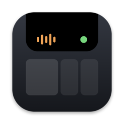
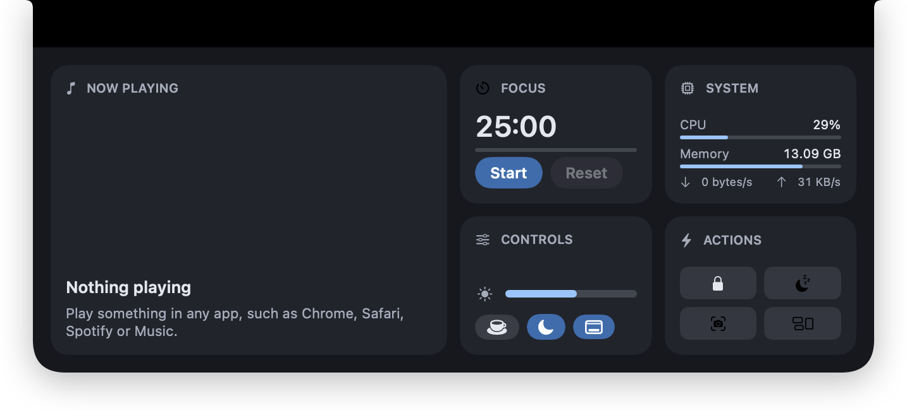
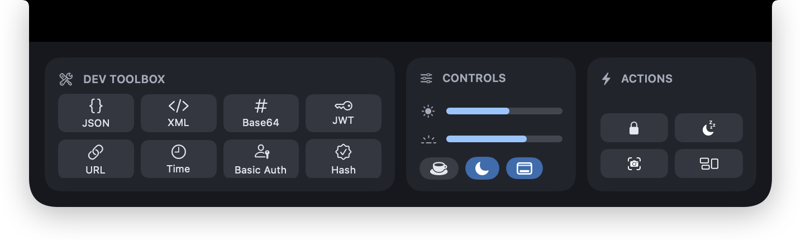
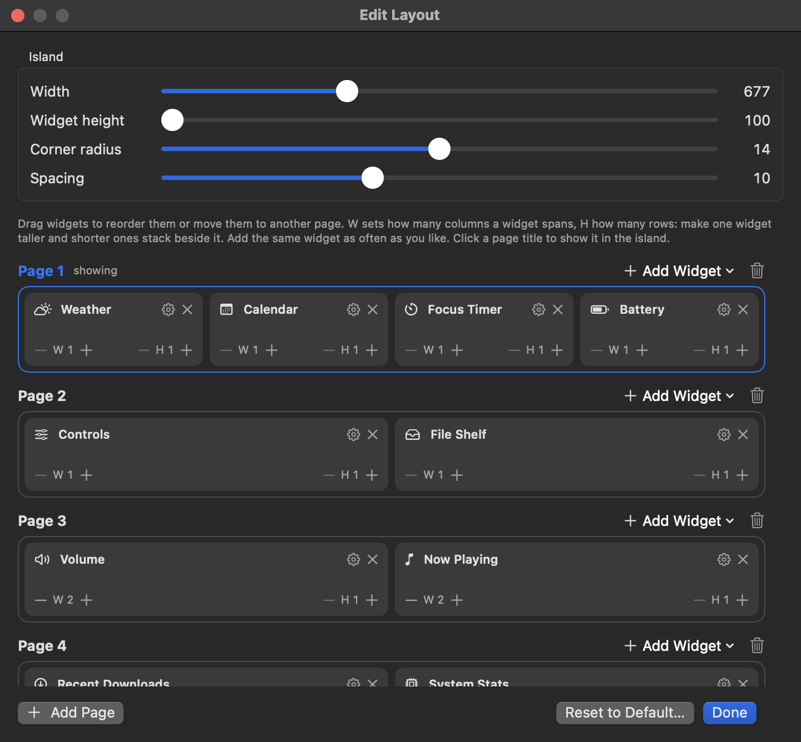
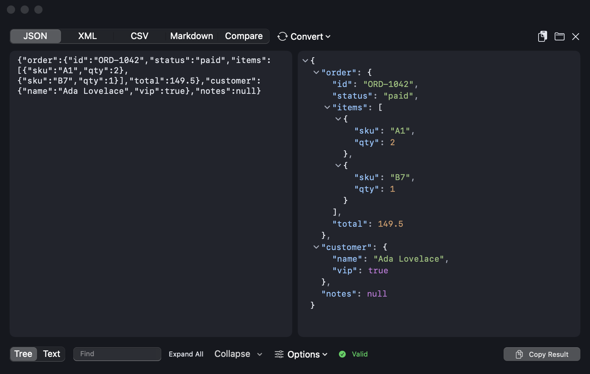
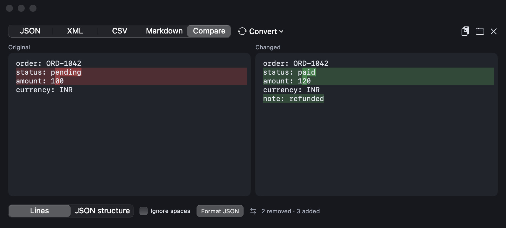
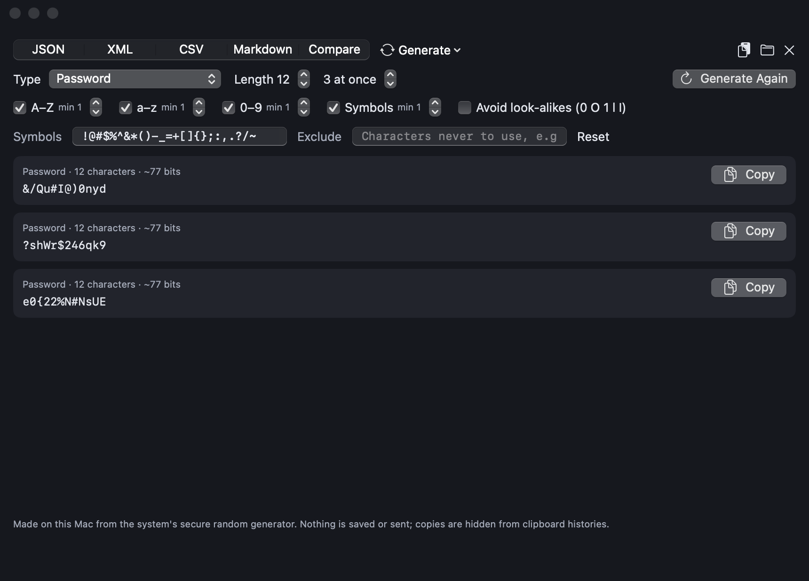
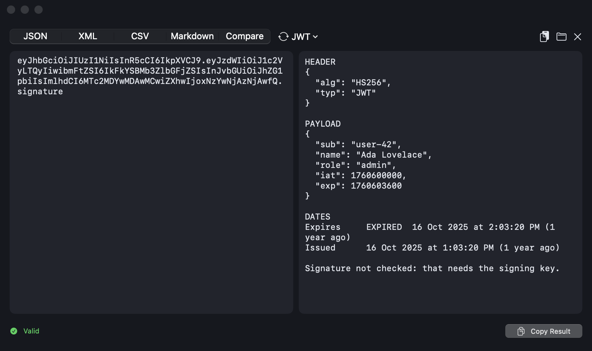

<p align="center">
  
</p>

<h1 align="center">Notch Island</h1>

<p align="center">
  The MacBook notch as a <b>Dynamic Island</b>: now playing, weather, calendar, focus timer, file shelf,
  quick controls, a developer toolbox, a 2-step authenticator, and <b>Claude Code live in the notch</b>
  (with Yes / Always / No for its permission prompts).
</p>

<p align="center">
  
  
  
</p>

<p align="center">
  
</p>

It lives in the menu bar, has no Dock icon, and only starts at login if you turn that on.
On Macs without a notch it draws one at the top centre of the screen.

**More than one display?** Choose in the menu bar (**Screens**) or in Settings:
- **Follows the Mouse** (default): one island, which moves to whichever screen your pointer is on (while it's closed).
- **On Every Screen**: an island on each display, all showing the same status. Only the one you hover opens;
  a Claude Code question shows on all of them, and answering on one clears it everywhere.
- **One Screen I Choose**: always on the display you pick (automatic: the notch screen, else the main one).

**Privacy:** only two kinds of request ever leave your Mac, lyrics ([LRCLIB](https://lrclib.net)) and
weather ([Open-Meteo](https://open-meteo.com)). No analytics, no accounts.

## Screenshots

| | |
|---|---|
| <br>**Widgets in a grid**: any width (1–4 columns) and height (1–3 rows) | <br>**Edit Layout**: drag widgets between pages, set sizes, tune the island |
| <br>**JSON / XML viewer**: collapsible tree, Find, Copy Path / Value, errors pinned to the line | <br>**Compare**: side by side, changed lines tinted, the exact changed characters marked |
| <br>**Password & key generator**: minimums per kind, symbols and exclusions; AES, HMAC, RSA, Ed25519 keys | <br>**JWT, Basic Auth, Hash, Base64, URL, Time**: decode and convert, all on your Mac |

## Install

### Download (no Terminal needed)

1. Download **NotchIsland-x.y.z.dmg** from the [Releases](../../releases) page, open it and drag
   **Notch Island** into **Applications**.
2. Open it from Applications. The first time, macOS says it can't verify the developer (the app isn't
   notarized): open **System Settings › Privacy & Security**, scroll down and click **Open Anyway**. Only once.
3. Look for the Notch Island icon (a small screen with the island at its top) in the menu bar. From its menu:
   **Copy Hook Settings JSON** (Claude Code), **Install "notch" Command** (scripts), **Launch at Login**.

### Build from source

```sh
git clone <this repo> NotchIsland && cd NotchIsland
./install.sh
```

That one script checks your Mac, creates a local signing certificate (once), builds the app, installs
it to `~/Applications/NotchIsland.app`, starts it, and prints the Claude Code hook settings.

| | Needed |
|---|---|
| macOS | 15 Sequoia or later |
| To build | Swift 6: Command Line Tools 16 or Xcode 16+ (`xcode-select --install`) |
| Mac | Apple Silicon or Intel (built for the Mac it's run on) |

Other commands:

```sh
./install.sh build        # build only, into build/NotchIsland.app
./install.sh hooks        # print the Claude Code hook settings again
./install.sh uninstall    # remove the app, its data and its permissions
./install.sh --no-cert    # skip the signing certificate (ad-hoc signature)
./install.sh dmg          # make build/NotchIsland-<version>.dmg for a GitHub Release (Apple Silicon + Intel)
./install.sh icon         # redraw Resources/AppIcon.icns from Helper/make-icon.swift
```

The signing certificate ("NotchIsland Dev", in your login keychain) keeps the app's signature the same
between builds, so macOS remembers the permissions you gave it. Without it, macOS asks again after every rebuild.

### Signing

`install.sh` keeps the "NotchIsland Dev" certificate in **its own keychain**
(`~/Library/Keychains/notchisland-signing.keychain-db`) with a random password it stores for you
(`~/Library/Application Support/NotchIsland Signing/`, readable only by your user). So it never needs your
Mac or keychain password, and avoids `errSecInternalComponent`. If signing still isn't possible, it builds
with an ad-hoc signature and says so: the app works, but macOS asks for permissions again after each rebuild.
To start over: `./install.sh uninstall` (answer **y** for the certificate), then `./install.sh`.

## Using it

- **Rest the mouse on the notch** (or click it) to open the island; it closes as soon as the pointer leaves.
- **Pages**: swipe sideways with two fingers or click the dots. Default pages: Now Playing, Weather, Calendar,
  Focus Timer · Now Playing, Volume, File Shelf · Controls, Battery, Reminders, Clipboard.
- **Edit Layout…** (menu bar icon): drag widgets between pages, reorder, set widths (W 1–4 columns) and heights (H 1–3 rows: shorter widgets stack beside a taller one, so a page can be a grid), add the same widget as often as you like, add or delete pages,
  set the island width, widget height, corner radius and spacing. The **gear** on a widget switches its parts
  on or off (for example which Focus Timer presets to show). Widgets also adapt to their size on their own.
  Close it with **Done**, ⌘W or Esc.
- **Compact pill**: while Claude works, a timer runs, music plays, or the microphone/camera is in use
  (orange dot = microphone, green dot = camera).
- **Bubbles**: apps opening and quitting, charger connected, battery at 20% / 10%, Focus on/off, headphones
  connecting (with AirPods battery when macOS reports it), network changes, mic/camera starting, Claude finishing.

### Widgets

| Widget | What it does |
|---|---|
| Now Playing | Whatever is playing in **any app** (Chrome, Safari, Spotify, Music…): cover, title, synced lyrics, previous/play/next, click the bar to seek |
| Weather | Temperature, icon, high/low for the city you set |
| Calendar | Next event, with a **Join** button for Zoom / Meet / Teams / Webex links |
| Focus Timer | 5–90 minute presets (choose which with the gear), start/pause/reset |
| Volume | **Output**: slider, mute, output device picker. **Apps**: each app playing sound gets its own slider and mute (Spotify 50%, Chrome 80%…; macOS 14.2+) |
| File Shelf | Drag a file toward the top of the screen and the island opens as a drop zone, or press **+**. Scroll up/down when there are many; drag files back out (into Finder, or into a terminal to paste the path for Claude Code), double-click to open, ✕ removes one, 🗑 clears all. Files from Desktop, Documents, Downloads or cloud folders reach apps like Slack as an instant clone, because those apps may not be allowed into those folders; Finder, terminals and editors get the real file |
| Clipboard | Last 10 copies, in memory only, skips passwords; off until you turn it on |
| Controls | Display brightness, keyboard backlight, keep awake, dark mode, desktop icons |
| Battery | Level, time left, top energy users |
| Reminders | Due today; tick to complete |
| System Stats | CPU, memory, disk free, network up/down |
| App Launcher | Your favourite apps; **+** to add, ✎ to remove |
| Countdown | Days and hours to a date you set in Settings |
| Color Picker | The system magnifier; copies the HEX, keeps recent colours |
| Quick Notes | Short notes, stored on your Mac; opens a small window to type |
| Quick Actions | Lock, display off, Screenshot, Mission Control |
| Recent Downloads | Your latest downloads, draggable into Finder or a terminal |
| Git | Branch, ahead/behind and changed files of the repo Claude is working in (or a folder you pick) |
| Ports | Local servers that are listening; open in the browser or stop (click Stop twice) |
| Docker | Containers with start/stop (if Docker is installed and running) |
| Authenticator | 2-step codes (TOTP) for your accounts with a countdown ring; click a code to copy it. Add with a QR picture (clipboard or file), a setup key, or `otpauth://` links: paste one per line to import many at once, each named from its link (issuer, account, digits, period, algorithm); accounts already added are skipped. Notch Island also registers for `otpauth://` links, which open the add window filled in. Keys are encrypted on this Mac with a Secure Enclave key: unlock once per launch with **Touch ID or your Mac password** (no Keychain password prompts, nothing to redo after updates; keys from older versions move over once); copied codes are marked so clipboard histories skip them |
| Dev Toolbox | Opens the viewer under the notch (the paste button brings in the clipboard; nothing loads on its own, so a huge copied JSON can't stall it). Tabs for JSON, XML, CSV, Markdown and Compare; a **Convert** menu for the **Password & Key Generator** (passwords of any length from 4 to 128 with strength in bits, minimum counts of uppercase / lowercase / digits / symbols, your own symbol set and characters to exclude; AES, HMAC and ChaCha20 keys; random bytes; UUIDs; Ed25519, P-256 and RSA key pairs as PEM — all from the system's secure random generator, never saved), **Hash** (MD5, SHA-1, SHA-256/384/512), **Basic Auth** (client ID + secret ↔ `Authorization` header), Base64, JWT, URL and Time. Every Copy button says **Copied** right where you clicked; secrets are hidden from clipboard histories. JSON over ~2 MB shows as text instead of a tree; JSON's extra switches sit in an **Options** menu: JSON and XML (collapsible tree with Find, Expand All, Collapse / fold below a level, right-click Copy Path / Copy Value, or formatted text; JSON keeps key order, can sort keys and minify; stringified JSON (`"{\"a\":1}"`, also unquoted or stringified twice) is unwrapped like JSON.parse, string values holding JSON are expanded (Parse nested), and Copy as String does JSON.stringify), JWT (header, claims, expiry in words; signature not checked), URL (decode with parts and query list / encode), Time (Unix seconds / ms / µs / ns or a date, shown in UTC, local, Unix and relative), Base64 (encode / decode), CSV (table), Markdown (rendered) and Compare (Original and Changed side by side, both editable, changed lines tinted and the exact changed characters marked; ignore spaces, Format JSON both sides, or compare by JSON structure: changed paths, key order ignored). Errors in JSON and XML highlight the exact line and column. The panel opens at a fixed width and grows or shrinks its height to fit the document |

The viewer also opens from **Dev Toolbox…** in the menu bar, **Open in Viewer** on Shelf and Downloads files, and
`notch view file.csv` in a terminal.

The **Clipboard** widget offers one-click tools for the latest copy when they apply: Pretty JSON,
Decode Base64, Decode JWT, Timestamp → date.

### Quick capture

- **Drop on the notch**: files and images go to the Shelf, text becomes a Quick Note.
- **New Screenshots → Shelf** (menu, off by default): screenshots you take appear on the Shelf.
- Right-click a Shelf file for **Share…** (AirDrop, Messages, Mail…) or **AirDrop**.

## The `notch` command

`./install.sh` links `~/.local/bin/notch` (add `~/.local/bin` to your PATH if it isn't). Use it from any
script or terminal:

```sh
notch "Backup finished"                 # a bubble
notch done "Deployed"   ·   notch fail "Tests broke"
notch run -- mvn test                   # shows it running, then Done/Failed with the time; keeps the exit code
notch run --title "Nightly import" -- ./import.sh
notch progress 40 "Importing"           # live % in the pill; `notch progress done "Importing"` to finish
notch ask "Run migration on prod?" "ALTER TABLE …" && ./migrate.sh   # Yes = exit 0, No = 1, no answer = 2
notch view data.json                    # open a JSON / XML / CSV / Markdown file in the viewer under the notch
```

When several things run at once (Claude sessions in different terminals, `notch run` commands, progress bars),
the open island shows one at a time with **‹ 1/3 ›** to switch, and the pill shows how many. Waiting questions
(Claude permissions and `notch ask`) get the same switcher. Other AI coding tools can be watched with
`notch run -- <tool>`.

## Claude Code

The island shows what Claude is doing (reading, editing, running, searching), opens with the **whole**
command when Claude asks for permission, and shows "Done" with how long it took. It works in **any**
terminal or IDE that runs Claude Code (Terminal, iTerm2, IntelliJ, VS Code, Warp…) and labels each
prompt with the app it came from; click the label to jump there.

Permission choices match the terminal: **Yes** (⌃⌥Y), **Always** (⌃⌥A: saves Claude Code's own
"don't ask again" rule, shown under the command) and **No** (⌃⌥N). If the command is longer than the box,
Yes and Always stay disabled until you've scrolled to the end. If you don't answer within 120 s, or the app
isn't running, Claude Code shows its normal prompt.

Add the hooks to `~/.claude/settings.json` yourself: `./install.sh hooks` prints them with your path, and the
menu has **Copy Hook Settings JSON**. If an event already has hooks, **add** this entry next to them:

```json
{
  "hooks": {
    "UserPromptSubmit": [{ "hooks": [{ "type": "command", "command": "\"$HOME/Applications/NotchIsland.app/Contents/MacOS/notch-hook\"" }] }],
    "PreToolUse": [{ "matcher": "*", "hooks": [{ "type": "command", "command": "\"$HOME/Applications/NotchIsland.app/Contents/MacOS/notch-hook\"" }] }],
    "PermissionRequest": [{ "matcher": "*", "hooks": [{ "type": "command", "command": "\"$HOME/Applications/NotchIsland.app/Contents/MacOS/notch-hook\"", "timeout": 150 }] }],
    "Notification": [{ "hooks": [{ "type": "command", "command": "\"$HOME/Applications/NotchIsland.app/Contents/MacOS/notch-hook\"" }] }],
    "Stop": [{ "hooks": [{ "type": "command", "command": "\"$HOME/Applications/NotchIsland.app/Contents/MacOS/notch-hook\"" }] }]
  }
}
```

Start a new Claude Code session afterwards. The hook talks to the app over a Unix socket that only your
user can open (`~/Library/Application Support/NotchIsland/notch.sock`).

## Permissions

Each is asked for only when you first use the feature.

| Permission | When | Why |
|---|---|---|
| Calendars | **Allow** in the Calendar widget | Show your next event |
| Reminders | **Allow** in the Reminders widget | Show reminders due today |
| Focus status | Turning on Focus bubbles in the menu | Show when Focus turns on/off |
| Automation → Spotify / Music | Only in the fallback (see Limits) | Read and control playback |
| Paste from other apps | Turning on Clipboard history (macOS may ask) | Keep recent copies |
| System Audio Recording | First time you turn an app below 100% | Per-app volume (audio is played straight back, never saved or sent) |
| Downloads folder | **Show** in Recent Downloads | List your latest downloads |
| Screenshots folder (Desktop by default) | Turning on New Screenshots → Shelf | Add new screenshots to the Shelf |
| Login item | Turning on Launch at Login | macOS shows its own notice |

No Accessibility, Bluetooth, Location, Microphone, Camera or Screen Recording access is needed.

## Limits

- **Now Playing for any app** uses MediaRemote, a private framework that, since macOS 15.4, only answers
  Apple-signed processes; the app loads a tiny helper into Apple's `/usr/bin/perl`, which still may. If a
  macOS update closes this, Now Playing falls back to Spotify and Music over AppleScript.
- **Brightness, keyboard backlight and dark mode** use the private frameworks Control Center uses
  (DisplayServices, CoreBrightness, SkyLight). If one disappears, that control hides (dark mode falls back to
  System Events, which asks for Automation once).
- **Do Not Disturb**: macOS only says whether *a* Focus is on, and only if it lets a self-signed app ask.
- **Camera in use** can't name the app; the microphone can.
- **Per-app volume** works by muting the app and replaying its audio at your level (Core Audio process taps).
  Nothing is muted until System Audio Recording is allowed, and if an app's replayed audio stays silent for a
  few seconds the tap is removed so its normal sound comes back. Lock uses a private call (as Control Center does).
- **Desktop icons** restarts Finder to apply.
- No screen-recording indicator: macOS gives apps no reliable way to know another app is recording.

### Making a release

1. Bump `CFBundleShortVersionString` in `Resources/Info.plist`.
2. `./install.sh dmg` and attach `build/NotchIsland-<version>.dmg` to a GitHub Release.
   It's signed with your "NotchIsland Dev" certificate, so the permissions people grant carry over to later
   releases, as long as you keep that certificate (`~/Library/Keychains/notchisland-signing.keychain-db`).
3. To remove the "unverified developer" step for users you need an Apple Developer account: set
   `DEVELOPER_ID="Developer ID Application: …"` and `NOTARY_PROFILE=<notarytool profile>` before
   `./install.sh dmg` and it signs with the hardened runtime and notarizes.

## Remove

```sh
./install.sh uninstall
```

It turns off the login item, quits the app, deletes the app, its settings, cache and socket, resets its
permissions, and offers to delete the signing certificate. Remove the hook entries from
`~/.claude/settings.json` yourself.

## Development

```sh
swift build              # compile
./install.sh test        # unit tests (Swift Testing)
./install.sh build       # full app bundle
```

| Path | What's in it |
|---|---|
| `Sources/NotchIsland/App.swift` | Startup, menu bar menu |
| `Sources/NotchIsland/IslandPanel.swift` | Notch detection, island states, panel, hover, file drops |
| `Sources/NotchIsland/IslandViews.swift` | Island shape, compact / peek / expanded views, carousel |
| `Sources/NotchIsland/Settings.swift` | Settings, pages/layout model, widget parts, settings window |
| `Sources/NotchIsland/LayoutEditor.swift` | Edit Layout window |
| `Sources/NotchIsland/MusicTile.swift` | Now Playing (system helper + AppleScript fallback), lyrics |
| `Sources/NotchIsland/InfoTiles.swift` | Weather, calendar, focus timer |
| `Sources/NotchIsland/SystemTiles.swift` | Volume/output, mic/camera, file shelf |
| `Sources/NotchIsland/MoreTiles.swift` | Clipboard, controls, battery, reminders, network, device bubbles |
| `Sources/NotchIsland/Peeks.swift` | App, power and Focus bubbles |
| `Sources/NotchIsland/CLITasks.swift` | `notch` command handling, running tasks, the ‹ › activity switcher |
| `Sources/NotchIsland/DevTiles.swift` | Ports, Git, Docker, clipboard tools |
| `Sources/NotchIsland/ExtraTiles.swift` | Stats, launcher, countdown, colour picker, notes, actions, downloads |
| `Sources/NotchIsland/AppVolume.swift` | Per-app volume (process taps) |
| `Sources/NotchIsland/Authenticator.swift` | TOTP codes, Keychain storage, QR reading, add-account window |
| `Sources/NotchIsland/TextTools.swift` | JSON / XML / Base64 / CSV / Markdown / Compare viewer and its pop-up panel |
| `Sources/NotchIsland/ClaudeBridge.swift` | Socket server, Claude state, permission view, shortcuts |
| `Sources/NotchIsland/Snapshots.swift` | Saves PNGs of the app's own windows for UI checks |
| `Sources/NotchHook/main.swift` | The `notch-hook` helper, which is also the `notch` command |
| `Helper/nowplaying.m` | System-wide Now Playing helper |
| `Helper/make-icon.swift` | Draws the app icon (`Resources/AppIcon.icns`, via `./install.sh icon`) |

**UI snapshots** (no screen-recording permission needed): send
`{"hook_event_name":"NotchIslandSnapshot"}` through `notch-hook` and the app writes a PNG of each of its
windows to `$TMPDIR/NotchIsland-snapshots`. Optional fields: `"page": 1`, `"options": "timer"`,
`"dropZone": true`, `"preview": "music:2,timer:1"` with `"height": 132` (and `"preview": ""` to end).

## License

[MIT](LICENSE)
